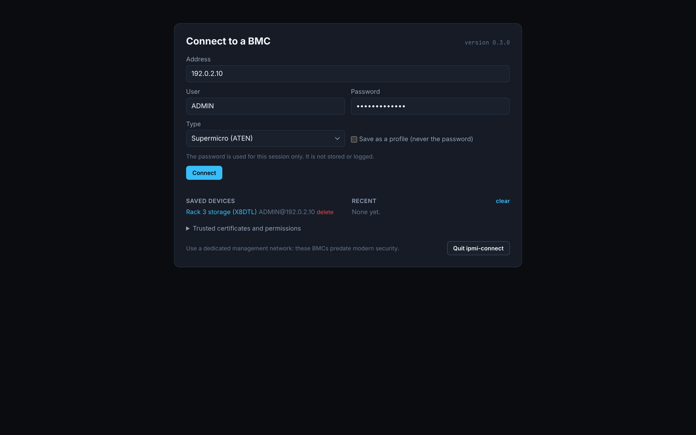
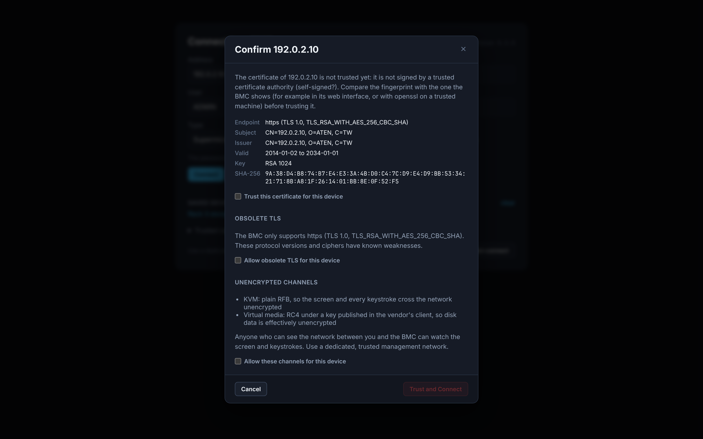
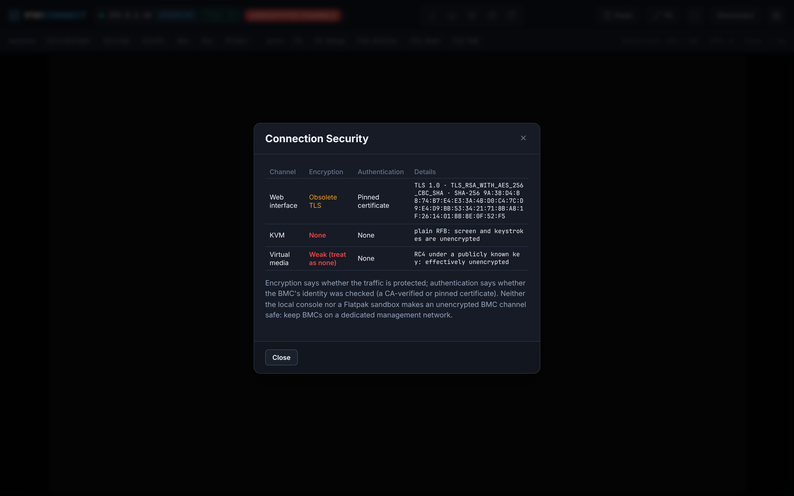
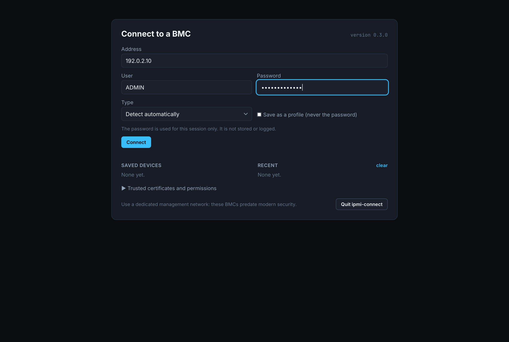
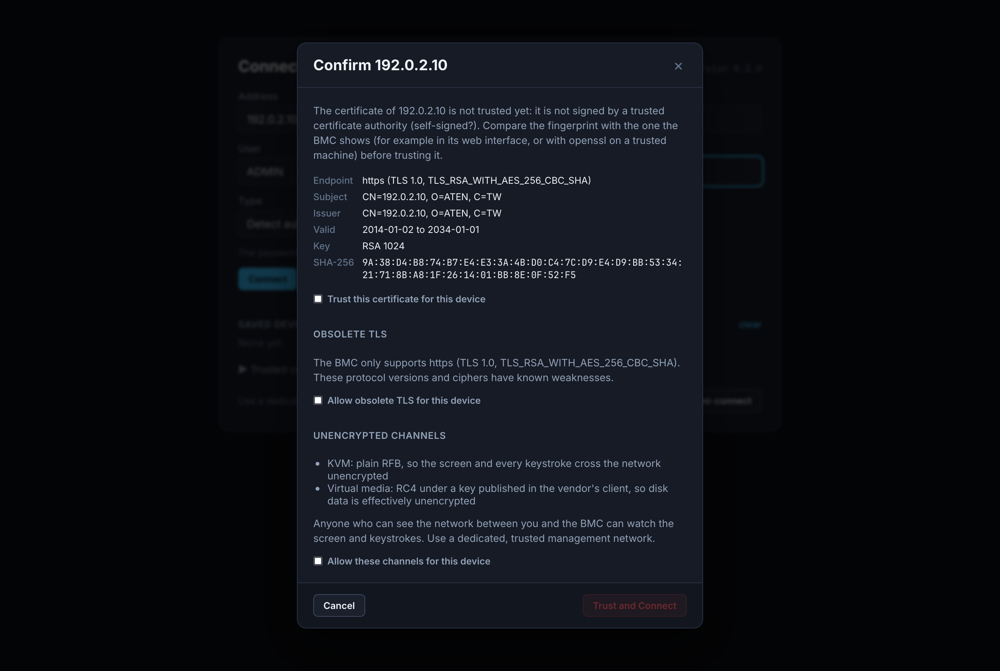
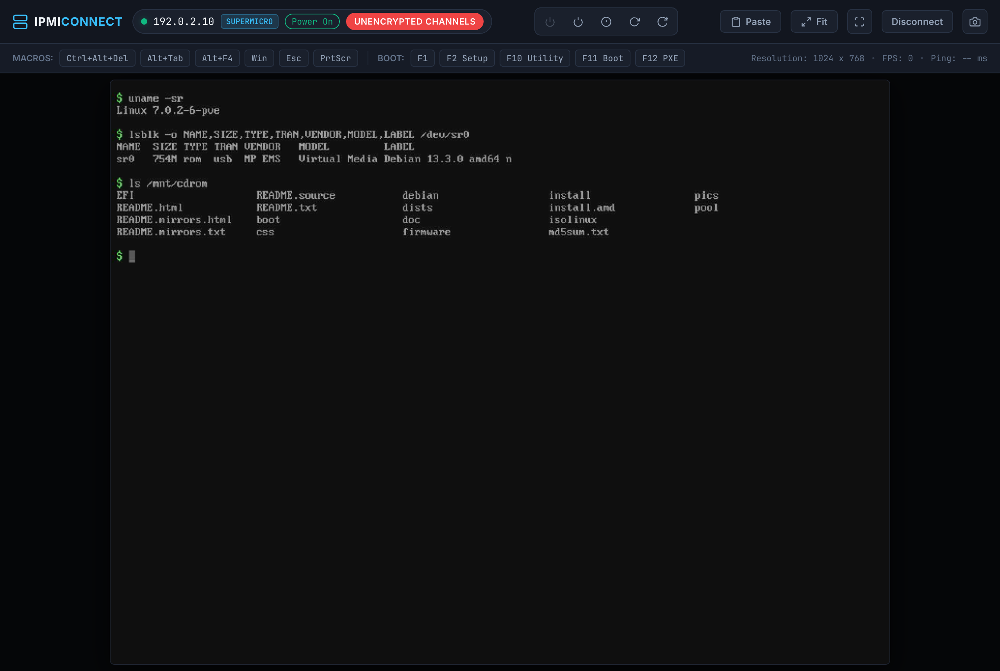
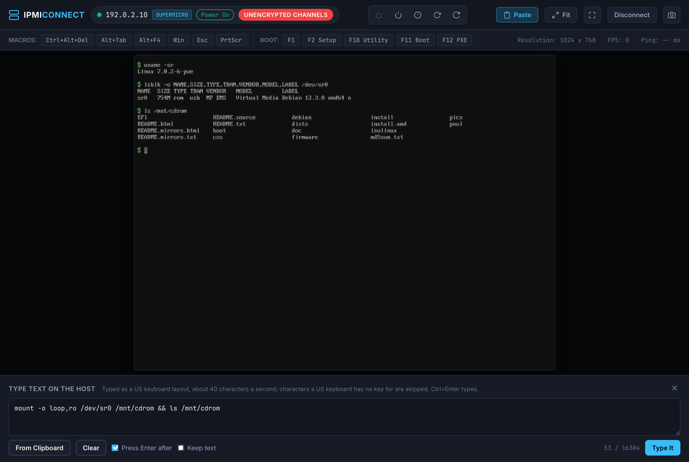

# ipmi-connect

A browser console for old Dell (Avocent), Supermicro (ATEN) and ASUS (AMI MegaRAC) server BMCs, so you never have to fight Java Web Start again. One Go binary: video, keyboard, mouse, power control and virtual media, all in a normal browser tab.


## Why

I have a couple of older servers whose BMCs only offer a Java Web Start (`.jnlp`) remote console. Every time I needed the console I had to find yet another workaround to get an old Java running, with old TLS settings, just to see a screen. It irritated me enough to do something about it.

ipmi-connect talks to the BMCs' own KVM and virtual media protocols directly and shows the console in your browser. No Java, and no messing with browser TLS settings. It now works really well for me, virtual media included: I've booted OS installers over it.

## Screenshots

| Connection manager | First connection: certificate and protocol consent |
| :---: | :---: |
|  |  |

| Connection security | Virtual media | Power control |
| :---: | :---: | :---: |
|  |  |  |

The console and virtual media pictures predate the security badge, the Disconnect button and the
Writable checkbox (images are now read-only by default). The connection manager, consent and
security pictures come from the scripted test app (`node test/e2e/screenshots.mjs`), with a
documentation address.

### Desktop window

The Flatpak and the `ipmi-connect-desktop` binary show the same interface in a native window
(GTK4 and WebKitGTK) instead of a browser tab.

| Connection manager | First connection |
| :---: | :---: |
|  |  |

| Console | Type text on the host |
| :---: | :---: |
|  |  |

The desktop pictures come from the same test app in the native window
(`test/e2e/desktop-screenshots.sh`); the host's screen is a picture taken from a real session.

## Supported hardware

It has been tested on the three boards I own (the ASUS module is newer to the project and experimental). Other BMCs running the same firmware families may work, but I can't promise anything.

| | Dell PowerEdge C6220 II | Supermicro X8DTL-6F | ASUS ASMB8-iKVM (experimental) |
| :--- | :--- | :--- | :--- |
| BMC | ASPEED AST2300, Avocent firmware 2.62.5 | Winbond WPCM450, ATEN firmware 3.13 | ASPEED AST2400, AMI MegaRAC SP firmware |
| KVM protocol | Avocent APCP, two TLS sockets on 7578 | ATEN RFB 3.8 on 5900 | AMI IVTP, tunnelled through the web server's TLS port (443) |

| Feature | Dell | Supermicro | ASUS (MegaRAC) |
| :--- | :--- | :--- | :--- |
| Login / clean logout | Works | Works | Works |
| Live video | Works (Go ASPEED decoder, verified frame-for-frame against Aspeed's reference) | Works (Go Hermon decoder) | Works (same Go ASPEED decoder) |
| Keyboard | Works (USB HID) | Works (USB HID) | Works (USB HID, type text verified) |
| Mouse | Works | Works (absolute position and buttons verified on hardware) | Implemented (absolute), not yet tested on hardware |
| Macros (Ctrl+Alt+Del, F-keys…) | Works | Implemented | Implemented |
| Power control | Works | Status verified; commands over the KVM socket or `ipmi.cgi` | Status verified; commands over the KVM tunnel, not yet tested on hardware |
| Virtual media | Works: ISO on CD/DVD (booted an installer), IMG on removable or floppy (read-write), Create Image, transfer graph, USB reset | Works: ISO on CD, IMG on removable or floppy (read-write), Create Image (blank or from a folder), all verified byte-exact on hardware; one drive at a time, see known issues | Works: ISO on CD, IMG on removable or floppy (read-write), verified on hardware; one drive at a time, and switching drive type waits two minutes, see known issues |

**ASUS ASMB8-iKVM (experimental).** This module runs AMI MegaRAC SP on an ASPEED AST2400, with
the KVM tunnelled through the web server's TLS port (`--type megarac`, or auto detection). Login,
power status, live video, keyboard and type text are verified on one board; mouse and power
commands are implemented but not yet tested on hardware, and virtual media is not implemented
yet. See [docs/asus-asmb8-ikvm.md](docs/asus-asmb8-ikvm.md).

The console also has a **type text** panel (paste or write text, and it is typed on the host as
keystrokes, optionally followed by Enter; Ctrl/Cmd+Shift+V on the console types the clipboard
straight away), screenshots, scaling and fullscreen with keyboard lock.

## Install

Pick one. Each release attaches native archives for Linux and macOS (amd64, arm64), Flatpak
bundles (x86_64, aarch64), `sha256sums.txt`, CycloneDX SBOMs and build-provenance attestations;
see [Verify a release](#verify-a-release).

### Standalone executable (Linux, macOS)

```bash
tar -xzf ipmi-connect_<version>_linux_amd64.tar.gz
```

```bash
install -Dm755 ipmi-connect ~/.local/bin/ipmi-connect
```

The Linux archives also carry `ipmi-connect-desktop`, the same program with its own window
(see [Desktop window](#desktop-window)) instead of a browser tab. It needs GTK 4.8+ and
WebKitGTK 6.0 (`libgtk-4-1` and `libwebkitgtk-6.0-4`: Debian 12, Ubuntu 24.04, Fedora 38 or
newer) and says which package is missing if they are not installed:

```bash
install -Dm755 ipmi-connect-desktop ~/.local/bin/ipmi-connect-desktop
```

On macOS, use the `darwin` archive; the first run may need **System Settings → Privacy &
Security → Open Anyway**, because the binary is not notarised.

### Flatpak (Ubuntu and other Linux desktops)

```bash
flatpak install --user ipmi-connect_<version>_linux_x86_64.flatpak
```

The bundle pulls the Freedesktop runtime from Flathub (ipmi-connect itself is not on Flathub).
Start **IPMI Connect** from the application menu, or `flatpak run io.github.a5m0.IPMIConnect`. Its
only permission is network access; see [Flatpak sandbox](#flatpak-sandbox).

On **Ubuntu** without Flatpak yet: `sudo apt install flatpak`, then log out and back in.

### ChromeOS (Crostini)

Turn on Linux (Settings → About ChromeOS → Developers), then in the Linux terminal either
install the standalone executable as above, or `sudo apt install flatpak xdg-desktop-portal-gtk`
and the Flatpak. ChromeOS's browser reaches the Linux container only through forwarded ports, so
on Crostini ipmi-connect uses port 8080 and `localhost` links; if the page does not load, add port
8080 under Settings → Developers → Linux → Port forwarding. ChromeOS support is not yet verified
on hardware.

### From source

You need Go 1.27.2 or newer (builds use the 1.27.4 toolchain named in `go.mod`).

```bash
go install github.com/a5m0/ipmi-connect/cmd/ipmi-connect@latest
```

Or `make build` in a clone, which writes `bin/ipmi-connect`. The Flatpak build is described in
[packaging/flatpak/README.md](packaging/flatpak/README.md).

## Use

### Desktop

Run `ipmi-connect` with no arguments (or use the launcher). Your browser opens a connection
manager on a private local address:

1. Enter the BMC's address, user and password, and pick the type (or leave **Detect**).
2. On first contact you see the BMC's certificate: compare its SHA-256 fingerprint with the one
   the BMC shows (see [Certificates](#certificates-and-pinning)) and confirm. If the BMC needs
   obsolete TLS or has unencrypted channels you are asked about those too.
3. The console opens. The header badge shows how the connection is protected; click it for
   details. **Disconnect** logs out and returns to the manager; connect to another BMC without
   restarting. In desktop mode, **Quit** logs out and stops ipmi-connect.

Saved devices and recent connections keep the address, user and type, never the password. After
30 minutes with no browser open, ipmi-connect logs out of the BMC and quits (`--idle-timeout`).

The link that opens the console works once and expires after two minutes. If you close the tab,
press Enter in the terminal (if you started it from one) for a new link, or start the app again.

### Command line

```bash
export IPMI_CONNECT_PASSWORD='your BMC password'
ipmi-connect 192.0.2.10                       # logs in as root and opens the console
ipmi-connect 192.0.2.20 -u admin --no-browser  # print the console link instead
```

The vendor is detected automatically; force it with `--type dell|supermicro|megarac`. Credentials come
from flags, then environment variables, then defaults:

| | Flag | Environment | Default |
| :--- | :--- | :--- | :--- |
| User | `-u` | `IPMI_CONNECT_USER` | `root` |
| Password | `-p` (deprecated) | `IPMI_CONNECT_PASSWORD` | interactive prompt |

`-p` still works but warns: flags are visible in the process list. On a terminal, untrusted
certificates and obsolete protocols are shown and must be confirmed. Scripts must authorise
them explicitly (decisions are remembered per device):

```bash
ipmi-connect 192.0.2.10 --trust-fingerprint SHA256:AB:CD:... --allow-legacy-tls
ipmi-connect 192.0.2.20 --type supermicro --allow-insecure-channels --trust-fingerprint ...
```

| Flag | Meaning |
| :--- | :--- |
| `--desktop` | connection manager (default without a host) |
| `--web-port <port>` | local port (default 8080 with a host, any free port in desktop mode) |
| `--no-browser` | print the link (valid 10 minutes) instead of opening it |
| `--idle-timeout <duration>` | log out and quit after this long with no browser (`0` disables) |
| `--media-dir <folder>` | also allow virtual media images from this folder (repeatable) |
| `--debug <areas>` | log protocol details for troubleshooting; also `IPMI_CONNECT_DEBUG` (merged, comma lists allowed). `megarac-media` traces each MegaRAC media command and reply status, never the data |
| `--trust-fingerprint <sha256>` | trust this certificate (repeatable) |
| `--replace-fingerprint` | replace a pinned certificate that changed (with `--trust-fingerprint`) |
| `--allow-legacy-tls` | allow TLS 1.0/1.1 and cipher suites without forward secrecy (static RSA, including RSA-GCM), CBC or 3DES for this BMC |
| `--allow-insecure-channels` | allow unencrypted KVM / virtual media channels for this BMC |

**Changed in this version:** earlier versions accepted any BMC certificate silently. A first,
non-interactive connection to a self-signed BMC now needs `--trust-fingerprint`.

Press Ctrl+C to exit. ipmi-connect logs out of the BMC first, because the Dell allows only **one**
console session; an unclean exit locks you out until the BMC times the session out.

## Use at your own risk

This is a hobby project, provided as is, with no warranty. If you use it, you do so at your own risk, and I'm not responsible for any damage or data loss it causes.

Be aware that it can power-cycle and reset servers, and that virtual media can write to disk images. Only use it on hardware you own or are allowed to manage, and try it on something unimportant first.

## Security

These BMCs predate modern security. **Keep them on a dedicated management network** (a VLAN that
only administrators' machines can reach, with the BMCs unable to reach the internet); nothing
ipmi-connect does makes an unencrypted channel safe on a shared network. Details:
[threat model](docs/security/threat-model.md), [sandbox](docs/security/sandbox.md),
[reporting vulnerabilities](SECURITY.md).

### Certificates and pinning

The BMCs use self-signed certificates. ipmi-connect accepts a certificate only if it is signed by
a trusted authority for the BMC's name, or its SHA-256 fingerprint is **pinned** for that BMC. On
first contact it shows the fingerprint and asks; nothing is sent to the BMC (no password, no
token) until every certificate the session will use is trusted. If a pinned certificate
changes, the connection is refused with a warning; replace the pin only if you know why it
changed (for example a firmware update).

Get the fingerprint from a trusted path, e.g. on the management network:

```bash
openssl s_client -connect 192.0.2.10:443 </dev/null 2>/dev/null | openssl x509 -noout -fingerprint -sha256
```

Pins and consents are stored in `known_hosts.json` in the configuration folder (on Linux
`~/.config/ipmi-connect/`, in the Flatpak `~/.var/app/io.github.a5m0.IPMIConnect/config/ipmi-connect/`,
on macOS `~/Library/Application Support/ipmi-connect/`). **Forget** in the connection manager
removes a device's entry.

Certificate checks say *who* you are talking to. They do not make the channel's encryption any
stronger: the badge reports both separately.

### Obsolete TLS and unencrypted channels

| | Dell C6220 II | Supermicro X8DTL-6F |
| :--- | :--- | :--- |
| Web login, power | TLS 1.0 (obsolete), certificate checked | TLS 1.0 with `AES256-SHA` (obsolete), certificate checked |
| KVM | TLS on the APCP port, certificate checked | **Unencrypted** RFB: screen and keystrokes in clear text |
| Virtual media | Same TLS channel | **RC4 under a key published in the vendor client**: effectively unencrypted |

Obsolete TLS and unencrypted channels are used only after you agree for that BMC, and the header
badge stays amber or red for the whole session. The Supermicro's own "KVM SSL" mode is not
supported. Your password is never sent on the KVM or virtual media channels; they use one-time
tickets from the web session.

### Local console

The console listens on 127.0.0.1 only and needs the one-time link. Requests from other sites,
other local ports or rebinding host names are refused; the session token is never put in URLs,
cookies or persistent browser storage; logging out closes every browser connection. Passwords are
never written to disk or logs.

### Virtual media

Images are offered only from your home folder (not hidden folders), ipmi-connect's private media
folder, folders given with `--media-dir`, and files you pick with **Choose File…** (the desktop's
file chooser). Images are attached **read-only** unless you tick **Writable** and confirm. Power
actions that can lose work ask for confirmation.

### Flatpak sandbox

The Flatpak can use the network and nothing else: no access to your files, SSH keys, devices,
container sockets, display server or host commands. Pick images with **Choose File…** (only that
file is shared with the app) or put them in
`~/.var/app/io.github.a5m0.IPMIConnect/data/ipmi-connect/media/`. Flatpak's network permission is
all-or-nothing: it does **not** limit the app to your BMC, and it does not protect unencrypted
BMC traffic. ipmi-connect itself only ever connects to the BMC you chose, on that BMC's ports. See
[docs/security/sandbox.md](docs/security/sandbox.md).

## Verify a release

```bash
sha256sum --check --ignore-missing sha256sums.txt
gh attestation verify ipmi-connect_<version>_linux_amd64.tar.gz --repo a5m0/ipmi-connect
```

## Uninstall

- Standalone: delete the executable, and optionally `~/.config/ipmi-connect` and
  `~/.local/share/ipmi-connect` (macOS: `~/Library/Application Support/ipmi-connect`).
- Flatpak: `flatpak uninstall --user --delete-data io.github.a5m0.IPMIConnect`.

## How it was built

This was entirely vibe coded, and I'm not ashamed of it lol. Without AI it would never have got done.

I used two models and switched between them. I generally prefer Claude Opus 5.5 (in [Claude Code](https://claude.com/claude-code)), but I only have the Pro plan and kept running out of tokens, so I also used Gemini 3.8 Flash (in [Antigravity](https://antigravity.google)).

Gemini did the reverse engineering, using [REA](https://github.com/morluto/rea) to work out the protocols from the vendors' viewer applets and BMC firmware. Claude did the refining and optimising, and fixed the mistakes Gemini made.

Everything was tested against my own hardware, and the protocol notes are in [docs/](docs/README.md). No vendor code is included; see [NOTICE](NOTICE).

## Similar projects

Other tools do some of this, but none did everything I wanted: both of my boards, in a browser, with virtual media from local files.

| Project | What it does | Why it didn't fit |
| :--- | :--- | :--- |
| [smkvm](https://github.com/glennswest/smkvm) | Native macOS console for ATEN iKVM (X8/X9/X10) | macOS only; no virtual media |
| [modern-idrac-client](https://github.com/the-curve-consulting/modern-idrac-client) | Go client and console for Dell iDRAC6/7/8/9 | Targets iDRACs, which the C6220's BMC is not; no Supermicro |
| [idrac-6-rs](https://github.com/SeineEloquenz/idrac-6-rs) | Java-free iDRAC6 console via a VNC bridge | iDRAC6 only; no virtual media or power control |
| [idrac-kvmclient](https://github.com/Informatic/idrac-kvmclient) | Python iDRAC KVM client with a VNC proxy | iDRAC only; virtual media listed as missing |
| [noVNC ATEN fork](https://github.com/kelleyk/noVNC) | noVNC with ATEN iKVM support | Video and input only; last updated in 2017 |
| [chicken-aten-ikvm](https://github.com/thefloweringash/chicken-aten-ikvm) | macOS VNC viewer with ATEN iKVM support | macOS only; no virtual media |
| [drac-kvm](https://github.com/PaulMaddox/drac-kvm) | Launcher for Dell's Java viewers | Still needs Java |

## Future plans

- Optional password storage in the desktop's Secret Service (keyring)
- Supermicro "KVM SSL" (encrypted KVM) firmware and newer BMC generations
- Screen recording
- Serial over LAN (SOL)

## Contributing

PRs are welcome, especially support for other boards and firmware. Please run `make` (lint, race tests, build) before sending one.

```bash
make            # lint, test, build
make test       # go test -race ./...
make lint       # go vet + golangci-lint (config in .golangci.yml)
make fmt
node test/e2e/ui.mjs   # browser test of the UI (needs Playwright with Chromium)
```

CI also runs govulncheck, licence checks, CodeQL, fuzzing and the Flatpak build.

Code layout:

```text
cmd/ipmi-connect/      CLI and desktop mode: flags, trust prompts, browser launch
internal/
  session/             One BMC session at a time: trust gate, vendor setup, stream loops, logout
  trust/               Certificate verification and pinning, TLS probes, trust store
  config/              Configuration paths, device profiles, recents
  portal/              xdg-desktop-portal OpenURI and FileChooser
  bmc/                 Shared types, the BMC endpoint (scoped dialler and HTTP client), password prompt
  dell/                Avocent client: web session, APCP channels, heartbeat, video, input, power
  supermicro/          ATEN client: CGI session, RFB handshake and input, power
  megarac/             AMI MegaRAC client: RPC session, single-port KVM tunnel, IVTP, input, power
  web/                 Local HTTP/WebSocket server, key macros, frame broadcast
    static/            Embedded browser UI
  aspeed/              ASPEED video decoder (Go port of Aspeed's MPL-2.0 reference)
  vmedia/              Virtual media manager: local image library, drives, transfer stats
  avmp/                Dell (Avocent AVMP) virtual media client
  atenvm/              Supermicro (ATEN Virtual Storage) virtual media client
  diskimage/           FAT image creation (blank, or from a folder)
  textkeys/            Text to USB HID key presses (US layout)
docs/                  Hardware notes, protocol specs, design, security, test checklists
packaging/flatpak/     Flatpak manifest, metadata and offline module sources
test/e2e/              Browser test against a scripted fake BMC session
```

## Known issues

- Supermicro: while the BMC's own web-UI media mount is active, it has one free virtual media slot, so a second drive is refused with "slots are full or busy".
- ASUS ASMB8 (MegaRAC): the BMC serves one virtual media drive at a time and keeps it for about two minutes after its connection closes; an attach in that window hangs, and while it waits the BMC's web interface stalls too. ipmi-connect keeps the drive's connection open across ejects, so swapping images on the same drive is instant; switching to another drive type (or re-attaching after a dropped connection) is refused with the time left until the BMC frees the drive. USB reset is not available.
- `--port` is accepted for compatibility but ignored.
- Desktop mode starts a new instance each time it is launched; a second launch does not reuse the first.

## Credits

- [REA](https://github.com/morluto/rea), the agent-driven reverse-engineering toolkit used to work out the protocols
- Eclypsium's [USBAnywhere](https://github.com/eclypsium/USBAnywhere) research, whose published Supermicro virtual media capture gave the test vectors
- ASPEED's [aspeed_codec](https://github.com/AspeedTech-BMC/aspeed_codec), the reference video decoder the Go decoder is ported from
- The projects in [Similar projects](#similar-projects), used as references to cross-check protocol details (no code was copied)
- Libraries: [coder/websocket](https://github.com/coder/websocket), [go-diskfs](https://github.com/diskfs/go-diskfs), [godbus/dbus](https://github.com/godbus/dbus) and [golang.org/x/term](https://pkg.go.dev/golang.org/x/term)

## License

Apache License 2.0; see [LICENSE](LICENSE) and [NOTICE](NOTICE). The ASPEED video decoder in `internal/aspeed/` is ported from Aspeed's reference implementation and stays under the Mozilla Public License 2.0; see [internal/aspeed/LICENSE](internal/aspeed/LICENSE).

ipmi-connect is an independent project, not affiliated with or endorsed by Dell, Vertiv (Avocent), ATEN, Supermicro, ASUS, AMI (American Megatrends) or ASPEED. Their names are used only to describe compatibility; see [NOTICE](NOTICE) for the trademark details.
