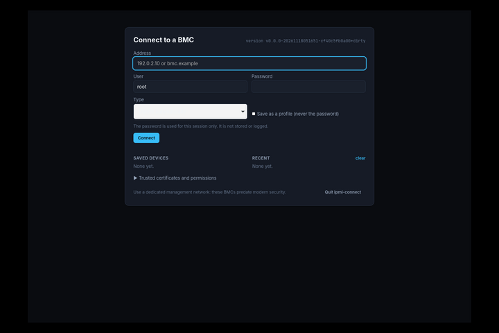

# Spike: the console in a native Wails v3 window

Status: spike, Linux only so far. The default build is unchanged and still opens the user's
browser; the native window exists only in builds with `-tags desktop`.

## What was built

- `cmd/ipmi-connect/window_desktop.go` (`desktop` tag): a Wails v3.1.0 application with one
  window. `run()` starts `web.Server` as before, but in desktop mode it hands the launch link to
  the window in-process instead of starting a browser. The page is the existing UI at
  `http://127.0.0.1:<port>/`, so the Host/Origin checks, token, WebSocket tickets and CSP
  stay exactly as they are.
- `window_default.go` (`!desktop`): a stub, so the default build doesn't link Wails at all
  (`go version -m` shows no Wails module).
- Closing the window quits through the normal path (`shutdown()`, then `Disconnect`). Quit
  button, idle timeout and SIGTERM close the window. SIGTERM was verified under Xvfb: the window
  closes and the "logging out of the BMC first" path runs.
- `make desktop` builds it. `FAKEAPP_STRESS=WxH@fps` makes the e2e fake app stream full-screen
  changes, for measuring drawing speed.

## Build

Wails v3.1 has an experimental **purego** Linux backend: it `dlopen`s GTK4 and WebKitGTK 6.0
at run time, so the build needs neither cgo nor a C toolchain.

| Build | Result |
| :--- | :--- |
| `CGO_ENABLED=0 go build -tags desktop,purego` (linux/amd64) | Works; 15 MB stripped, dynamically linked to libc only |
| Same, cross-compiled to linux/arm64, darwin/amd64, darwin/arm64 | Compiles (not run: no Mac or arm64 desktop here) |
| `CGO_ENABLED=1 go build -tags desktop,gtk3` (GTK3 + WebKit2GTK 4.1) | Works |
| Default build | Unchanged: static, 10 MB, no Wails |

So the release script's cross-compile matrix can stay as it is. At run time the purego binary
needs `libgtk-4-1` and `libwebkitgtk-6.0-4` (GTK 4.8+ and WebKitGTK 2.40+, i.e. Debian 12,
Ubuntu 24.04, Fedora 38 or newer). Wails reports one clear error naming the missing package
when they're absent.

Dependencies added: `wailsapp/wails/v3` (MIT), `ebitengine/purego` (Apache-2.0),
`go-ole/go-ole` (MIT); `coder/websocket` moves from 1.8.12 to 1.8.14 because Wails requires it.
`go mod vendor` ignores build tags, so all four are now in the Flatpak sources even though the
Flatpak build doesn't use them yet (`go-modules.json` and `modules.txt` are regenerated).

## Measurements

Ubuntu 24.04, 4 vCPUs, Xvfb with software rendering, WebKitGTK 2.52.6 against Chromium 153
headed on the same display. Each run streams raw RGBA frames where every 16×16 tile changes
every frame (the worst case; a real BMC sends only changed tiles), measured for 10 s after
connecting through the real consent flow.

| Stream | WebKitGTK frames/s | Chromium frames/s | WebKitGTK longest stall | Chromium longest stall |
| :--- | ---: | ---: | ---: | ---: |
| 1024×768 at 30 fps | 17.2 | 25.4 | 437 ms | 117 ms |
| 1024×768 at 60 fps | 12.7 | 24.8 | 268 ms | 100 ms |
| 1920×1080 at 30 fps | 7.0 | 9.4 | 403 ms | 150 ms |

Both engines fall short of the source rate here (the fake app and software rendering share four
cores), but WebKitGTK reaches about 70% of Chromium's throughput and its main thread is
starved: 6 to 8 animation frames a second against Chromium's 22 to 24, so input and UI feel
laggy under full-screen motion. Real hardware with GPU compositing will do better; the ratio is
the useful number. The likely fix is in `app.js`, not the shell: draw all of a message's
rectangles into one `ImageData` and call `putImageData` once (today it is once per 16×16 tile,
about 50 calls per frame), or decode in a worker onto an `OffscreenCanvas`.

## Behaviour in WebKitGTK

| Check | Result |
| :--- | :--- |
| Sign-in with the launch code, code removed from the address, token in `sessionStorage` | Works |
| Consent dialog, connect, video, WebSocket | Works |
| CSP violations or script errors | None |
| `isSecureContext` on `http://127.0.0.1` | true |
| Clipboard read API | Present |
| Fullscreen API | Present |
| Keyboard Lock (`navigator.keyboard.lock`) | **Missing.** Chromium-only. In a native window Ctrl+W, Ctrl+T, F5 etc. reach the page anyway; Alt+Tab and Super still go to the desktop |
| Screenshot button (`<a download>`) | **Silently does nothing.** Wails doesn't handle WebKit downloads on Linux; needs a Go-side save (dialog via Wails or the FileChooser portal) |
| `<select>` styling | Native GTK widget, light on the dark theme (see image); needs CSS |
| Memory | Main process about 290 MB RSS with software GL, plus WebKit's network and web processes (each in WebKit's own bubblewrap sandbox) |

## Security notes

- The one-time code goes from the server to the webview in memory; it never appears on a
  command line. This closes the argv exposure noted in `browser.go` and the threat model, for
  the desktop build.
- Wails injects scripts into every page the window loads, including ours: `window._wails`,
  `window.wails` and a blob-fetch shim. WebKit user scripts bypass the page's CSP. The page can
  post to the `external` message handler, which reaches Wails' own window commands (drag,
  resize, etc.) and `RawMessageHandler`. We register no bindings or services, and Wails' HTTP
  runtime calls go to `/wails/runtime` on our origin, where our server answers 404. Before
  shipping, decide whether to disable or allowlist those messages, and add an e2e check that the
  window can't navigate away from `127.0.0.1:<port>`.
- WebKitGTK's web process runs in its own bubblewrap sandbox. Inside Flatpak that needs the
  GNOME runtime and `--socket=wayland --socket=fallback-x11 --device=dri`; the Flatpak hasn't
  been changed yet.

## Not done / next steps

1. Flatpak: switch to `org.gnome.Platform`, add the display permissions, set
   `LinuxOptions.ApplicationID` (already `io.github.a5m0.IPMIConnect`) and update
   `docs/security/sandbox.md`.
2. Screenshot saving through Go; fix the `<select>` styling for WebKit.
3. Batch `putImageData` per message, then measure again, ideally on a real BMC and real GPU.
4. Run it on macOS (purego WKWebView is also experimental; cgo is the fallback) and decide on
   signing and notarising an `.app`.
5. Lock down Wails' injected messaging and navigation, with an e2e test driving the real window.
6. Window close while a BMC session is active was not tested under Xvfb (no window manager);
   SIGTERM was.

The browser build stays: CLI use, ChromeOS/Crostini and machines without GTK4/WebKitGTK still
need it.
